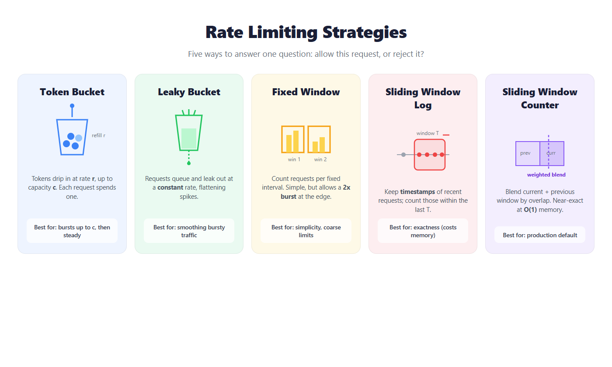
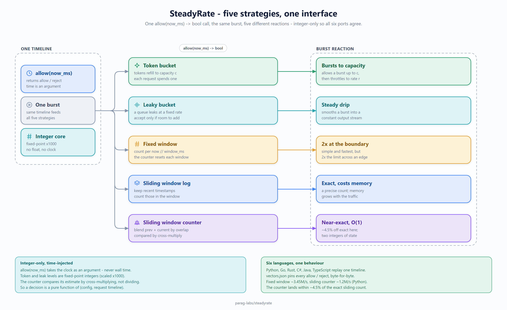

# steadyrate

Five rate-limiting strategies — token bucket, leaky bucket, fixed window, sliding
window log, and sliding window counter — implemented in **six languages** with
identical decisions, proven byte-for-byte by a shared set of golden vectors. Plus an
interactive visualizer that fires a burst and shows how each one reacts.

[](https://github.com/parag-labs/steadyrate/actions/workflows/tests.yml)


**▶ [Live visualizer](https://parag-labs.github.io/steadyrate/)** — set the limit, fire
a burst, and watch all five strategies accept or reject each request.





*Architecture at a glance — one `allow(now_ms)` timeline fanning out to all five strategies and their burst reactions. Source: [`docs/diagrams/architecture.svg`](docs/diagrams/architecture.svg).*

## Why

Rate limiting answers one question — allow this request now, or reject it? — and the
naive answer (a counter that resets each interval) quietly lets through *twice* the
limit at every window boundary. There are several better answers, each trading burst
tolerance, accuracy, and memory differently. I kept re-deriving them, so I wrote one
clean version of each, made them agree across languages, and built a demo that shows
why you'd pick one over another.

## The five strategies

| Strategy | Idea | Best for |
|----------|------|----------|
| **Token bucket** | Tokens refill at rate *r* up to capacity *c*; a request spends one | Allowing bursts up to *c* |
| **Leaky bucket** | A queue that drains at a constant rate | Smoothing bursts into a steady stream |
| **Fixed window** | Count per fixed interval | Simplicity (allows a 2x edge burst) |
| **Sliding window log** | Timestamps of recent requests | Exactness (costs memory) |
| **Sliding window counter** | Weighted blend of current + previous window | The production default: near-exact, O(1) memory |

Full write-up of each and the trade-offs in **[DESIGN.md](DESIGN.md)**.

```python
from limiters import TokenBucket, SlidingWindowCounter

tb = TokenBucket(capacity=10, refill_per_sec=5)
tb.allow(now_ms=0)      # -> True/False, spends a token if available

swc = SlidingWindowCounter(limit=100, window_ms=1000)
swc.allow(now_ms=1500)  # near-exact sliding window, O(1) memory
```

Every limiter takes the current time as an argument and decides with **integer
arithmetic only** — no floating point, no reading the clock — which is what lets the
six ports agree exactly.

## Six languages, one behavior

| Language | Run | Conformance |
|----------|-----|:-----------:|
| Python | `cd python && PYTHONPATH=src pytest -q` | ✓ |
| Go | `cd go && go test ./...` | ✓ |
| Rust | `cd rust && cargo test` | ✓ |
| C# (.NET 10) | `cd csharp/tests && dotnet test` | ✓ |
| Java (17+) | `cd java && mvn test` | ✓ |
| TypeScript | `cd web && npm test` | ✓ |

Each port ships a conformance test that replays the request timeline in
**[conformance/vectors.json](conformance/)** through every strategy and asserts it
reproduces the exact allow/reject vector. If any language disagrees, CI fails.

## Numbers

Measured, reproducible (`python bench/benchmark.py`), detail in
**[BENCHMARKS.md](BENCHMARKS.md)**: fixed window is fastest (~3.4M decisions/sec); the
sliding window counter costs a bit more CPU but stays O(1) memory and lands within
~4.5% of the exact sliding-window count — the accuracy/memory trade that makes it the
common production choice.

## Layout

```
steadyrate/
├── python/         reference implementation + pytest
├── go/             Go port
├── rust/           Rust crate
├── csharp/         .NET 10 port
├── java/           JDK 17+ port (Maven)
├── web/            TypeScript core + the interactive visualizer (Vite/React)
├── conformance/    golden vectors + generator; the cross-language contract
├── bench/          throughput + accuracy benchmark
├── DESIGN.md       the strategies, the integer-only trick, the trade-offs
└── BENCHMARKS.md   reproducible numbers
```

Part of [parag-labs](https://github.com/parag-labs) — small, focused tools for building systems you can trust.
